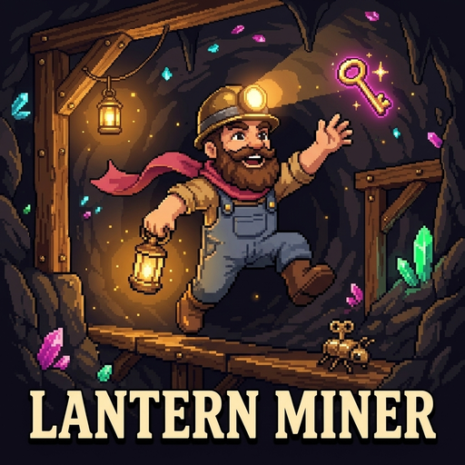
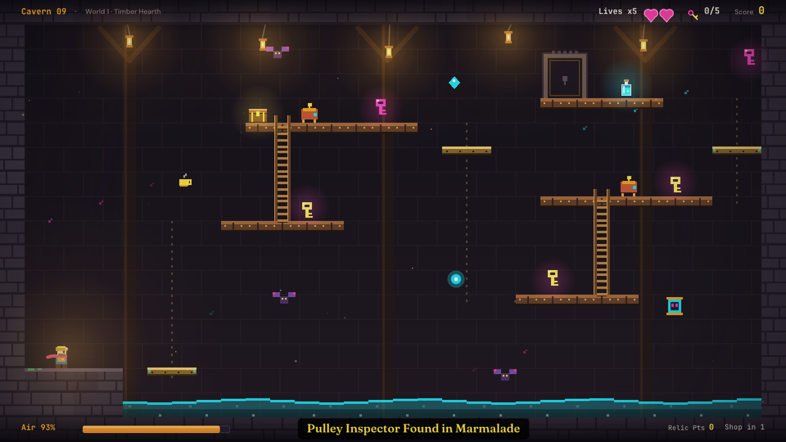
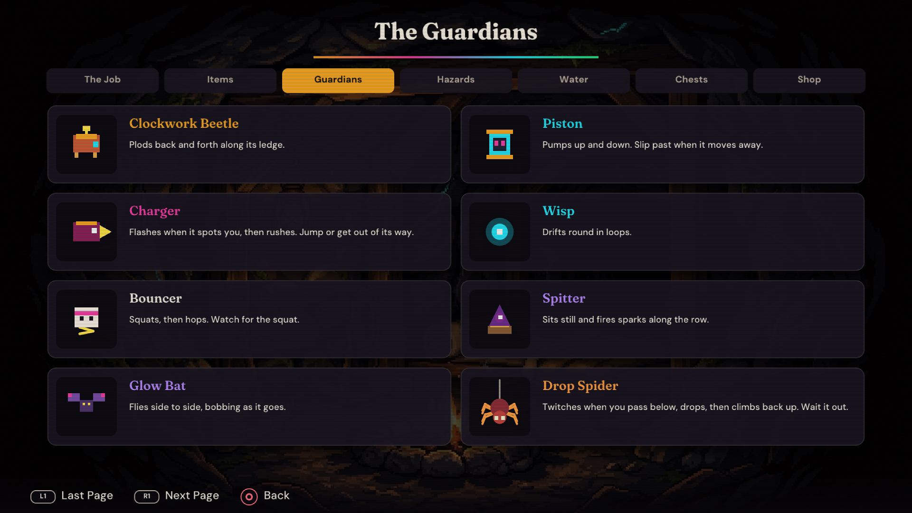

<p align="center">
  
</p>

<h1 align="center">Lantern Miner</h1>
<p align="center">A cavern platformer for jailbroken PS5 · <b>Beta v0.9.2</b> (Build 16) · <code>PPSA58001</code></p>


I wanted to make a game like *Manic Miner* and *Jet Set Willy*, as a homage to Matthew Smith. I grew up with those old ZX
Spectrum games and I still love them. So this is a proper old-school one: simple to pick up, hard to master, and the sort
of game that makes you want to rage quit, then have one more go.

It's written in C with Vulkan.

## It's a beta

So far there's **one finished world** (ten caverns) plus **13 extra caverns** after it. The plan is 50 caverns across five
worlds, with water, ice, wind and fire still to come. I'll keep building it, so let me know if anything's odd or unfair.

What's new in each version is in the [change log](CHANGELOG.md).

## What you're in for

Grab all the keys, get to the door and head down to the next cavern. Sounds easy. It isn't.

- **Your air runs out**, and fast. There's only one air bottle in each cavern
- **Mind the drop.** Fall too far and you lose a life
- **Eight kinds of guardian**, from clockwork beetles to a stalker that follows you through walls
- Ladders, lifts, moving platforms, conveyors, crumbling ledges, brambles and deep water
- **Chests are a gamble.** Some are treats, some give you lead boots, muddle your controls, leak your air or set something on you
- **Old Barnaby's shop** every 5th cavern, with new stock each visit
- **Lives are a luxury.** You get 5, with 2 hearts each, and buying more costs a fortune
- Continues are rare: buy one, find one, or clear a whole world without dying
- Daft room names in the old tradition, like *Pulley Inspector Found in Marmalade*
- Your game saves as you go, and there's a top 10 high score table

Stuck? There's a **How to Play** screen on the title and pause menus, with a key to everything.






## Controls

| Action | Button |
| --- | --- |
| Move | D-pad or left stick |
| Jump | Any face button, shoulder or trigger (hold to jump higher) |
| Climb ladders | Up / Down |
| Pause | Options |
| Mute | R3 |
| Menus | ✕ select, ○ back |
| Switch shop shelf or help page | L1 / R1 |
| Leave shop | Options |

## Install

1. Download `LanternMiner-v0.9.2-beta.zip` from **Releases** and unzip it.
2. Copy the `PPSA58001` folder to `/data/homebrew/` on your PS5.
3. Launch it and enjoy (or don't, and throw the pad).

Saves live in `/data/lantern-miner/`.

## Buy me a coffee

If you're enjoying it, or you just want me to hurry up with World 2, you can
[buy me a coffee](https://www.buymeacoffee.com/superfurry). Scan the code or click it.

<a href="https://www.buymeacoffee.com/superfurry"></a>

## Building

You'll need WSL (Ubuntu), the PS5 payload SDK and the PS5 Vulkan toolchain. See `tools/build-title.sh` for where it expects them.

```
wsl -d Ubuntu -- bash tools/build-title.sh
```

After changing the version or the theme tune, run `python tools/make_presentation.py` to remake the home screen art and music.

## Credits

- Made by **RedHotBallBag**
- A homage to **Manic Miner** and **Jet Set Willy** by Matthew Smith. It's a fan game and isn't affiliated with or
  endorsed by their makers
- Fonts: Fraunces, DM Sans and JetBrains Mono (SIL Open Font Licence)
- `stb_image.h` and `stb_truetype.h` by Sean Barrett
- Built on **PS5 Vulkan** by Mihawk-99, the **PS5 payload SDK**, **ps5-native-app-boilerplate** by BlackBearReloaded and
  **Mesa**. Thank you all

## Licence

The code is free software under the [GPL-3.0-or-later](LICENSE), so you can use it, change it and share it on the same
terms. The art, music and name are mine: pass them on with the game, but please don't use them for something else. Full
details are in [THIRD_PARTY_NOTICES.md](THIRD_PARTY_NOTICES.md).
