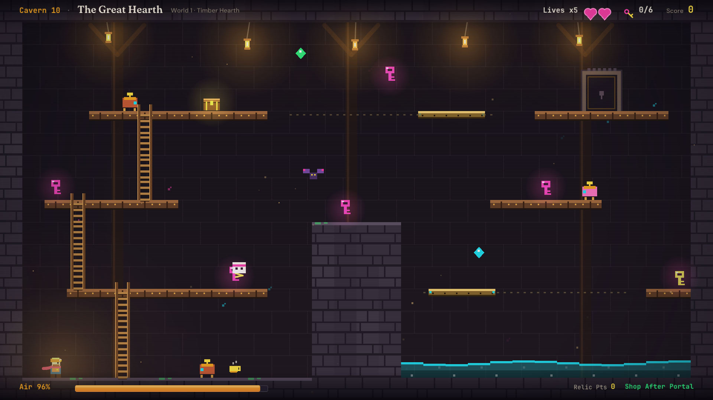
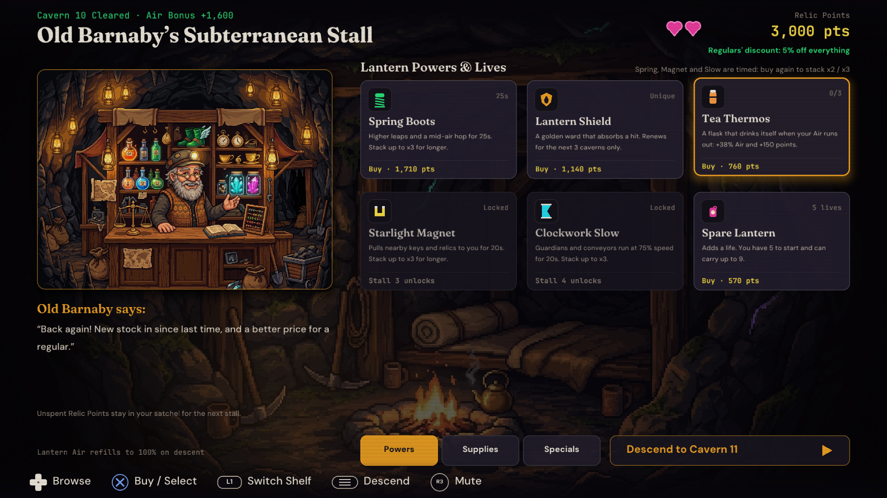

<p align="center">
  
</p>

<h1 align="center">Lantern Miner</h1>
<p align="center">A cosy cavern platformer for jailbroken PS5 · <b>Beta v0.7</b> · <code>PPSA58001</code></p>


I grew up playing old ZX Spectrum games like *Manic Miner* and I still love them, so I made my own for the PS5. Same simple,
hard but fair feel, with a warmer look and a few extras. It's written in C with Vulkan.

## How to play

Grab all the keys, get to the portal and head down to the next cavern. Watch your air, and watch out for the guardians.

- 23 hand-built caverns so far, heading for 50 across 5 worlds
- World 1 is finished, with ten caverns from gentle to tricky
- Ladders, lifts, moving platforms, conveyors, crumbling ledges and deep water
- Lucky chests with a surprise inside
- Old Barnaby's shop every 5th cavern, with new stock each visit
- You get 5 lives, with 2 hearts each
- Continues are rare: buy one, find one, or clear a whole world without losing a life
- Your game saves as you go
- Top 10 high score table





## Controls

| Action | Button |
| --- | --- |
| Move | D-pad or left stick |
| Jump | Any face button, shoulder or trigger (hold to jump higher) |
| Climb ladders | Up / Down |
| Pause | Options |
| Mute | R3 |
| Menus | ✕ select, ○ back |
| Switch shop shelf | L1 / R1 |
| Leave shop | Options |

## Install

1. Download `LanternMiner-v0.7.0-beta.zip` from **Releases** and unzip it.
2. Copy the `PPSA58001` folder to `/data/homebrew/` on your PS5.
3. Launch it and enjoy.

Saves live in `/data/lantern-miner/`.

It's still a beta, so let me know if anything's odd. Water, ice, wind and fire worlds are on the way.

## Building

You'll need WSL (Ubuntu), the PS5 payload SDK and the PS5 Vulkan toolchain. See `tools/build-title.sh` for where it expects them.

```
wsl -d Ubuntu -- bash tools/build-title.sh
```

## Credits

- Made by **RedHotBallBag**
- Inspired by **Manic Miner** by Matthew Smith (1983). This is a fan homage and isn't affiliated with or endorsed by its makers
- Fonts: Fraunces, DM Sans and JetBrains Mono (SIL Open Font Licence, see `assets/fonts/`)
- `stb_image.h` and `stb_truetype.h` by Sean Barrett
- PS5 display and Vulkan start-up code adapted from **PS5 Vulkan** by Mihawk-99 (GPL-3.0-or-later). Builds also use its RADV
  driver and the PS5 payload SDK

Builds are private, so please don't share them around.
