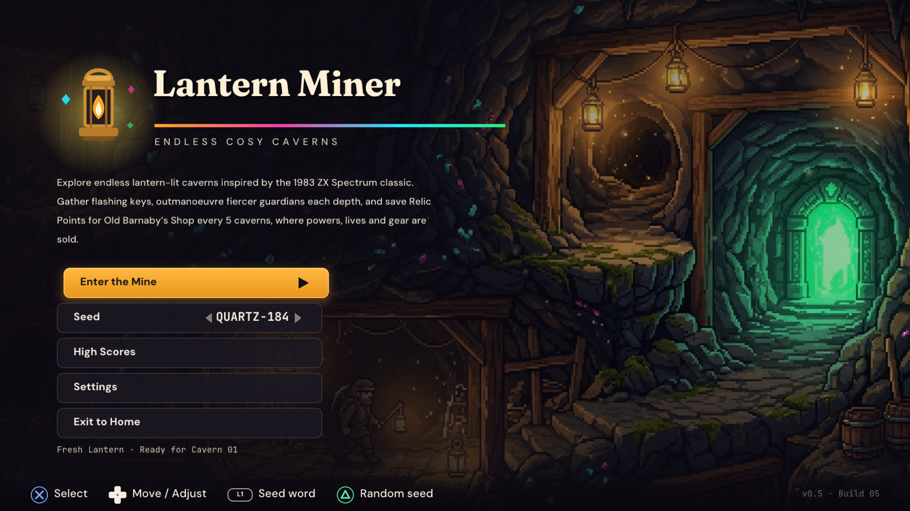
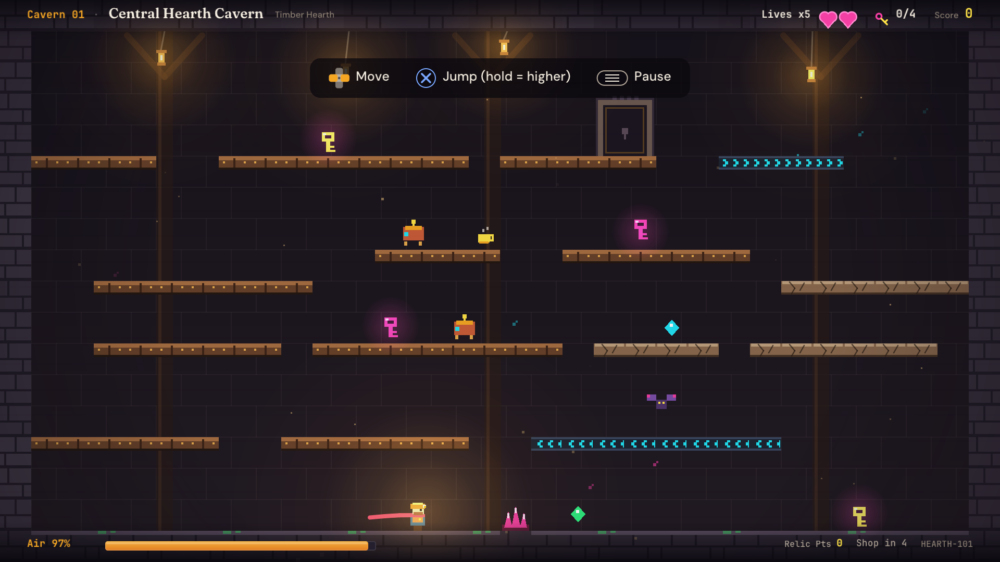
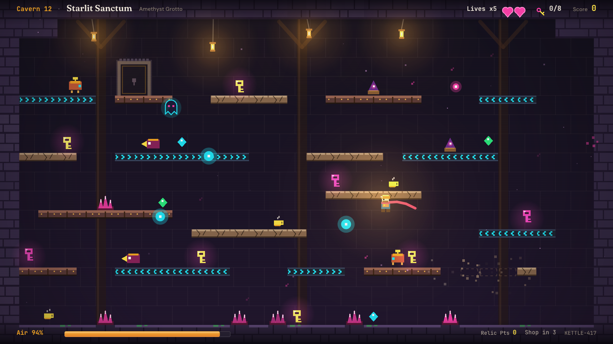
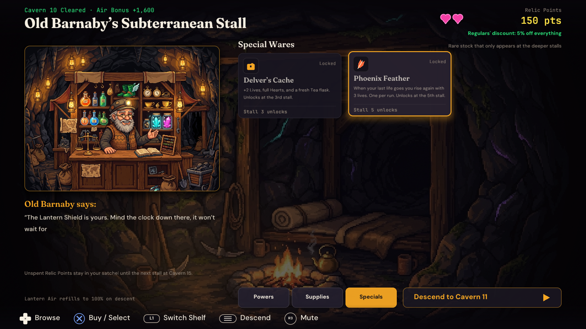
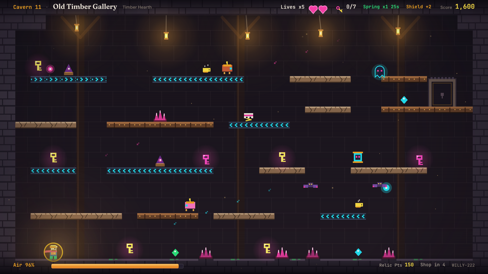
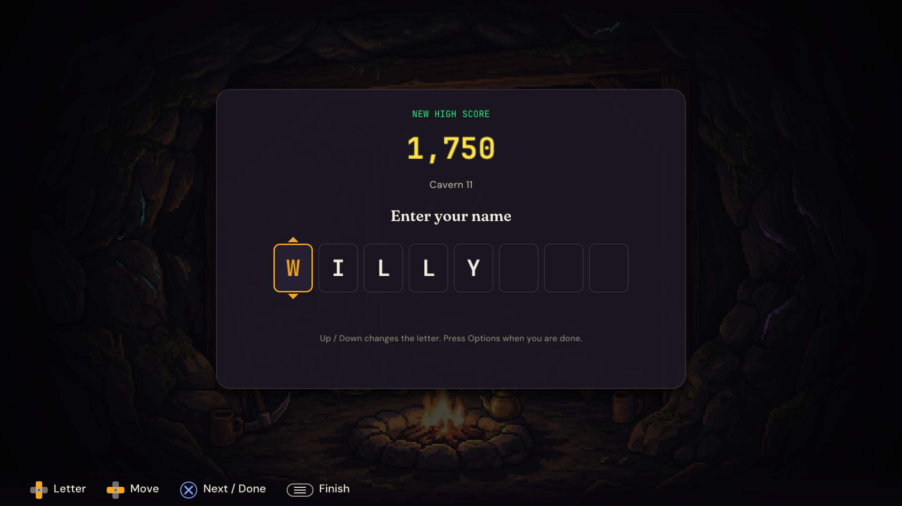
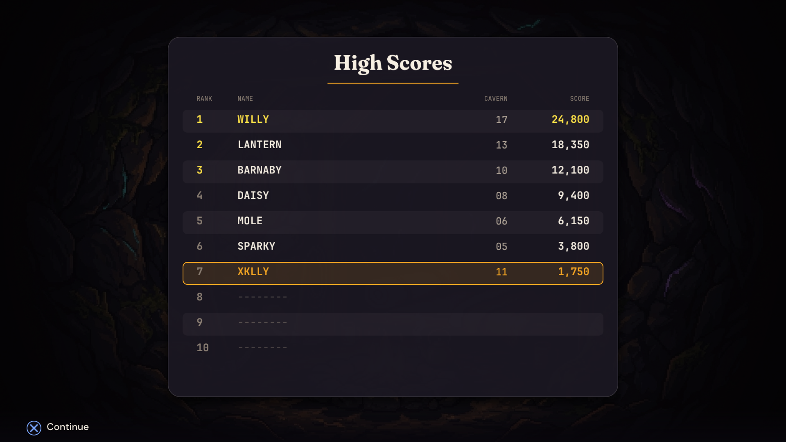

<p align="center">
  
</p>

<h1 align="center">Lantern Miner</h1>
<p align="center"><i>Endless cosy caverns for jailbroken PS5, inspired by the 1983 ZX Spectrum classic.</i></p>

<p align="center">
  <b>Beta v0.5 (Build 05)</b> · native PS5 homebrew · title ID <code>PPSA58001</code> · written in C with a Vulkan renderer
</p>



---

## Why this exists

I grew up with the old ZX Spectrum games. Games like *Manic Miner* (1983): one screen at a time, a little miner, keys to
collect, guardians that patrol back and forth, and air that is always running out. I loved them as a child and I still enjoy them
now, so I wanted to make a game like them: the same simple, hard-but-fair feeling, but with a warm modern coat of paint and the
kind of extras (a shop, upgrades, a high score table) I always wished those games had.

Lantern Miner started as a small web prototype. This version is a complete native rewrite for the PS5, written in C, with its own
Vulkan renderer, its own audio synthesiser and its own level generator. Nothing from the web version is left in the project.

> Lantern Miner is a fan-made homage. It is not affiliated with, or endorsed by, the makers of *Manic Miner* or any other
> Spectrum game.

## The game in one minute

You are **Willy**, a miner with a headlamp, a red scarf and a very small amount of air. Every cavern is a single screen
of platforms. Collect every **key** to unlock the **portal**, step through it, and descend to the next, harder, cavern. Your
**Lantern Air** drains all the time. If it runs out, you lose a life. Touch a guardian or a bramble twice, and you lose a life.
Every fifth cavern you reach **Old Barnaby's Subterranean Stall**, where you spend the **Relic Points** you have collected on
power-ups, extra lives and permanent upgrades. How deep can you get?



## Controls

| Action | Button |
| --- | --- |
| Move | D-pad or left stick |
| Jump | **Any** face button (✕ ○ □ △) or any shoulder / trigger (L1 R1 L2 R2). Hold for a higher jump, tap for a short hop |
| Pause | Options |
| Mute | R3 |
| Menus | D-pad to move, ✕ to select, ○ to go back |
| Title: change seed | L1 / R1 change the seed word, Left / Right change the number, △ picks a random seed |
| Shop | D-pad to browse, ✕ to buy, L1 / R1 switch shelf, Options to descend |
| Name entry | Up / Down change the letter, Left / Right move, ✕ next letter, ○ or □ backspace, Options finish |

The game is deliberately generous with the jump button, so you can play comfortably with whichever finger is nearest.
There is also a little coyote time and a jump buffer, so a jump pressed just before landing, or just after leaving a ledge,
still counts.

## How a run works

- **Lives.** You start with **5 lives** (up to 9). Each life has **2 hearts**: two hits and the life is gone. Running out of Air
  also costs a life.
- **Losing a life** restarts the same cavern with full Air and full hearts, plus two seconds of protection. Shield renewals are
  not used up by a retry. With no lives left, the run is over.
- **Lantern Air.** You start each cavern with 100%. It drains at a steady rate that creeps up as you go deeper (about 65% faster
  at the deep end). Collecting a **key** gives back 9%, and a **relic** gives back 6%.
- **Keys.** Every cavern holds a set of keys (typically four to seven). Collect them all and the portal opens.
- **Portal.** Walk into the open portal to finish the cavern. You get an **Air bonus** (6 points per 1% of Air left) plus a
  **depth bonus** (100 points per cavern number), so finishing fast and deep pays well.
- **Relics.** Gems scattered about the cavern. Each is worth `100 + 10 x depth` points, and the same amount goes into your
  **Relic Points** purse, which is the money you spend in the shop. Keys are worth 200 points each.
- **Seeds.** Every run uses a seed such as `HEARTH-654`. The same seed always builds exactly the same caverns, so you can race a
  friend or retry a cavern you know.

## The caverns

Each cavern is one screen: a 32 x 18 tile grid, generated from the seed and the depth. The generator builds the layout, then
**checks that every key and the portal can actually be reached with your jump**, and retries until it can. Caverns get harder as
you descend: more guardians, faster guardians, faster conveyor belts, and faster-draining Air.

### Tiles

| Tile | What it does |
| --- | --- |
| Stone | Solid. Walls, floors, ceilings. |
| Timber ledge | A one-way platform you can jump up through and stand on. |
| Conveyor belt (left / right) | Carries you along. Gets faster with depth. Conveyor Cleats resist it. |
| Crumbling sandstone | Shakes when you stand on it, then breaks, then grows back. Crumble Lightfoot makes it last longer. |
| Crystal bramble | Spiky. Costs a heart and knocks you back. |

### The five biomes

The first five caverns walk through the biomes in order, then they mix. They change the look and the cavern names; the rules
stay the same.

1. **Timber Hearth**: warm amber wood and lanterns.
2. **Glow-Moss Hollow**: green moss, ferns and fireflies.
3. **Amethyst Grotto**: purple crystal and pink glow.
4. **Clockwork Cellar**: brass cogs and pendulums.
5. **Frost-Lantern Vault**: icy blue stone.

Every fifth cavern is named *Old Barnaby's Threshold*: the shop is waiting once you clear it.

### The guardians

Guardians appear gradually, so the early caverns are gentle and the deep ones are properly busy.

| Guardian | From cavern | Behaviour |
| --- | --- | --- |
| Clockwork beetle | 1 | Patrols a platform back and forth. |
| Glow-bat | 1 | Flutters through the open air. |
| Bouncer | 2 | A springy patroller that hops as it goes. |
| Piston | 3 | Slides up and down a vertical shaft. |
| Wisp | 4 | A floating ghost that drifts in a loop. |
| Spark charger | 5 | Patrols a longer platform and darts at you. |
| Prism spitter | 7 | Sits on a ledge and fires projectiles. Up to two per cavern. |
| Shadow stalker | 10 | Roams the whole cavern and hunts you. Two of them from cavern 18. |



## Old Barnaby's Subterranean Stall

After every **fifth** cavern the game pauses at a campfire and you meet Old Barnaby. Spend your Relic Points on three shelves.
Unspent points carry over to the next stall. The shop shows "Shop in N" in the corner of the screen so you know how far away it is.

**Regulars get a discount**: 5% off everything for every stall after the first, up to 30% off. So the deeper you get, the
cheaper everything becomes.


### Shelf 1: Powers and lives

Powers are **temporary and cost real points**. They are strong, so they are priced accordingly.

| Item | Base price | What it does |
| --- | --- | --- |
| Spring Boots | 1,800 | Higher leaps and a mid-air hop for **25 s**. |
| Lantern Shield | 1,200 | A golden shield that absorbs one hit. It **renews at the start of each of the next 3 caverns**, then it is gone. |
| Tea Thermos | 800 (up to 3) | A flask that drinks itself when your Air hits 0: **+38% Air** and +150 points, instead of losing a life. |
| Starlight Magnet | 2,600 | Pulls nearby keys and relics to you for **20 s**. |
| Clockwork Slow | 3,000 | Guardians and conveyors run at **75% speed** for 20 s. |
| Spare Lantern | 600 | **+1 life** (up to 9). |

**Timers and the x2 / x3 stack.** Spring Boots, the Magnet and Clockwork Slow run on a timer that only counts down while you are
actually playing (not in the shop, on pause, or while the cavern banner is showing). Buy one again while it is still running and
you add another full timer, up to **x3**, but each extra stack costs more: **x2 is +75%** and **x3 is +150%** of the base price.
The HUD shows the time left, for example `Magnet x2 34s`.

### Shelf 2: Supplies and gear

| Item | Price | Max | What it does |
| --- | --- | --- | --- |
| Warm Kettle Brew | 300 | repeatable | Restores 1 missing heart. |
| Lantern Ward Charm | 450 | 1 at a time | Start the next cavern wrapped in a golden shield. |
| Crumble Lightfoot | 700 | 3 | Crumbling ledges hold 75% longer under your boots. |
| Conveyor Cleats | 1,100 | 2 | Run 12% brisker and resist 55% of conveyor push. |
| Big Brass Lantern | 1,400 | 2 | Air drains 22% slower and your headlamp glows wider. |
| Teacup Resonance | 2,400 | 2 | Permanent gentle treasure pull and **+35% Relic Points and score**. |
| Featherstep Slippers | 3,200 | 1 | Permanent mid-air flutter (double jump) and extra ledge grace. |
| Heart of the Hearth | 4,500 | 2 | +1 maximum heart, and refills all hearts. |
| Master Chronometer | 6,500 | 1 | Permanently slows all guardians and sparks by 20%. |

These are the **permanent** upgrades: they last the whole run.



### Shelf 3: Special wares

Rare stock that only appears at deeper stalls. The items show as locked until then.

| Item | Price | Unlocks | What it does |
| --- | --- | --- | --- |
| Delver's Cache | 4,000 | 3rd stall (cavern 15) | **+2 lives**, full hearts and a free Tea Thermos. |
| Phoenix Feather | 9,000 | 5th stall (cavern 25) | Once per run: when your last life goes you rise again with 3 lives. |

With a few powers running, the top bar shows them all at a glance:



## High scores

The game keeps a **top 10 table**. When your run ends with a score that makes the table, you are asked for your name (up to eight
characters, arcade style) and your score, name and cavern depth are saved. The table is on the title screen under
**High Scores**.




## Settings

Music and effects volume, sound on/off, **scanlines** (off / subtle / strong, for that CRT feeling), lantern bloom, controller
rumble and screen shake. They are saved automatically.

## Install (jailbroken PS5)

You need a console that can run homebrew and a way to send files to it.

1. Download the release zip from the **Releases** page and unzip it.
2. Copy the `PPSA58001` folder to `/data/homebrew/PPSA58001/` on your PS5.
3. Launch **Lantern Miner** from your usual homebrew launcher.
4. If it misbehaves, try the `PPSA58001-safe` folder (the same game built without link-time optimisation) in its place.

The game keeps its save data in `/data/lantern-miner/` (`save.cfg` for settings and records, `scores.cfg` for the high score table).
Delete that folder to start fresh.

The launch screen, loading splash and title screen all show the version, so you can tell which build you are running.

## Building from source

The PS5 build runs under WSL (Ubuntu) and links against the PS5 payload SDK and the PS5 Vulkan (RADV) toolchain, which are not
included here. `tools/build-title.sh` documents the layout it expects.

```
wsl -d Ubuntu -- bash tools/build-title.sh                            # optimised build  -> build/PPSA58001
LANTERN_LTO=0 LANTERN_OUT_SUFFIX=-safe bash tools/build-title.sh      # no LTO fallback  -> build/PPSA58001-safe
```

There is also a **desktop preview** that runs the whole game on a PC with software Vulkan and writes the screenshots in
`docs/screenshots/`:

```
wsl -d Ubuntu -- bash tools/host-app.sh
```

To change the version, edit `LM_VERSION` / `LM_BUILD` in `ps5/game/lm.h`, then run `python tools/stamp_pic1.py` to stamp it onto
the console launch background, and rebuild.

### Project layout

| Path | What is in it |
| --- | --- |
| `ps5/game/` | The game: engine, level generator, audio synthesiser, world renderer, UI and menus |
| `ps5/gfx/` | The Vulkan 2D renderer (`vkr.c`), shaders and the stb image / font libraries |
| `ps5/platform/` | The PS5 entry point: display, DualSense input, audio output, main loop |
| `ps5/host/` | The desktop preview harness |
| `assets/` | Fonts, key art, the console icon and launch background, the hover-music source |
| `tools/` | Build, shader, font and branding scripts |

## Credits and licences

- Game design, direction and testing: **RedHotBallBag**.
- Inspired by **Manic Miner** (Matthew Smith, 1983) and the wider world of ZX Spectrum platformers.
- Fonts: Fraunces, DM Sans and JetBrains Mono, all under the SIL Open Font Licence 1.1 (see `assets/fonts/`).
- `stb_image.h` and `stb_truetype.h` by Sean Barrett (public domain / MIT).
- The PS5 display and Vulkan start-up code is adapted from **PS5 Vulkan** by Mihawk-99 (GPL-3.0-or-later), and the console
  build is linked with the PS5 Vulkan RADV driver and the PS5 payload SDK. These come from their own projects and are not part of
  this repository. Because of that, **treat any build as private and do not redistribute it** beyond people you trust.

## Status

This is a **beta**. It has been played through on a real console, but new features (lives, the shop rebalance, the high score
table) are newer than the last full console test. Please report anything odd.
